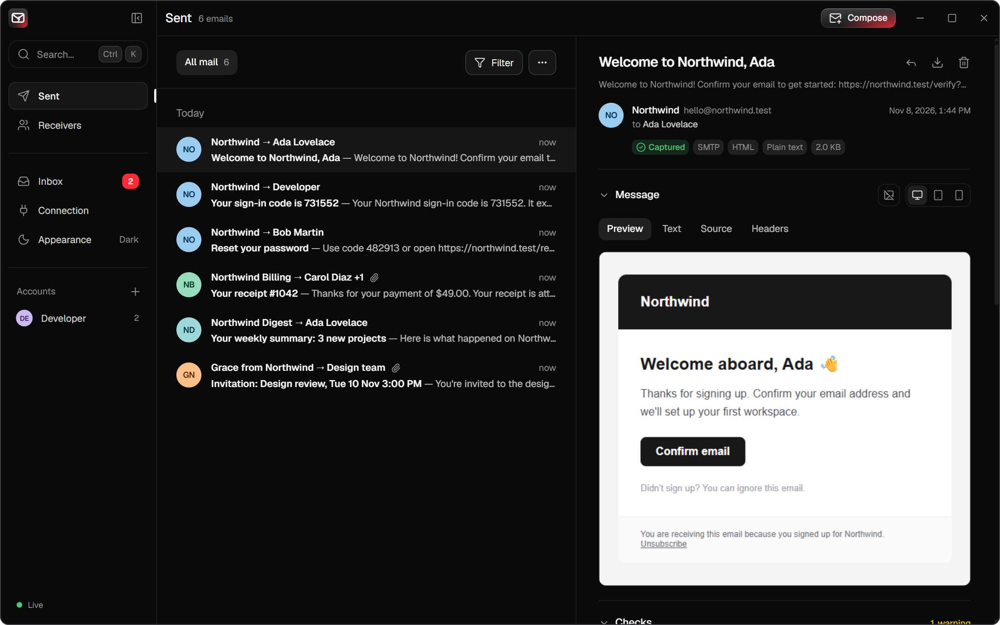
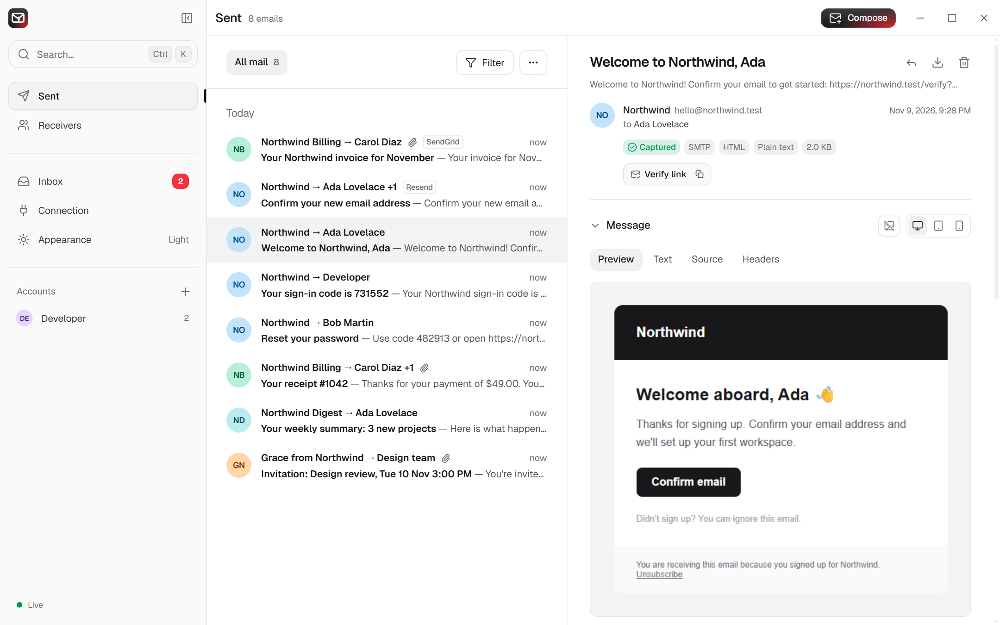
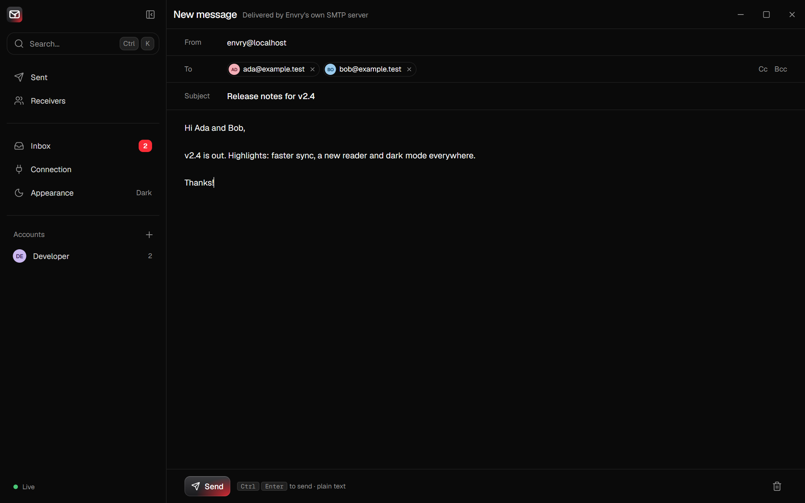
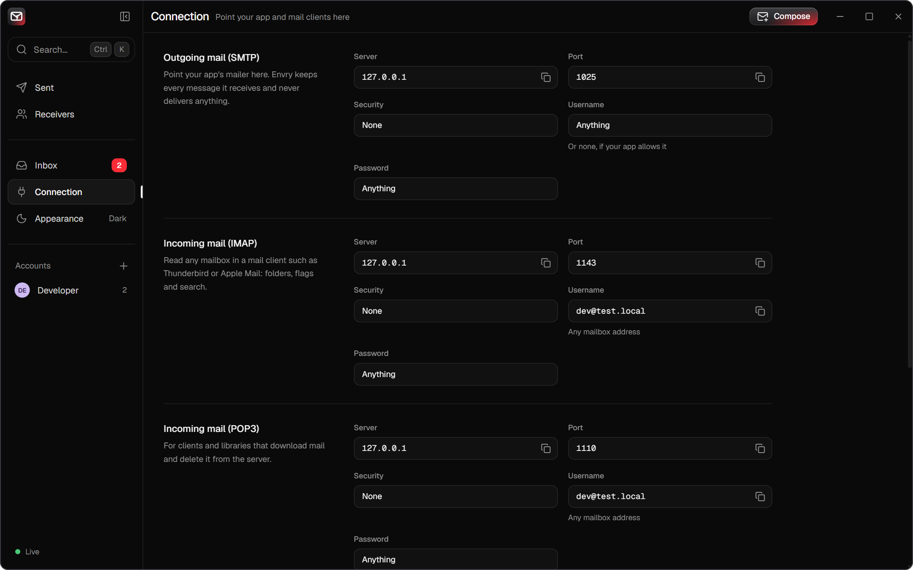

<p align="center">
  
</p>

<h1 align="center">Envry</h1>

<p align="center">
  A desktop app for testing email locally, on Windows, macOS and Linux.<br>
  It catches every email your app sends, gives each recipient a mailbox, and serves them back over IMAP, POP3 and a REST API.<br>
  Nothing is ever delivered to the internet.
</p>

<p align="center">
  <a href="https://github.com/arifurrahmanns/envry/releases/latest/download/Envry-setup-windows-x64.exe"><b>Windows</b></a> ·
  <a href="https://github.com/arifurrahmanns/envry/releases/latest/download/Envry-macos-universal.dmg"><b>macOS</b></a> ·
  <a href="https://github.com/arifurrahmanns/envry/releases/latest/download/Envry-linux-x86_64.AppImage"><b>Linux</b></a> ·
  <a href="https://github.com/arifurrahmanns/envry/releases/latest">All downloads</a>
</p>



> **Status:** early development; expect breaking changes before 1.0. SMTP capture, POP3, IMAP (all with optional TLS), the desktop app, the REST API, message checks and failure simulation work today.

## Features

- **A real desktop app.** Envry lives in the tray (the menu bar on macOS) with a Live/Offline status and a count of new mail, shows a notification when mail arrives, and can start at login. Closing the window keeps it catching mail.
- **Updates itself.** Envry downloads new versions in the background and installs them when you choose **Restart to update**.
- **SMTP capture** on port 1025. Any username and password are accepted.
- **A mailbox per recipient**, created automatically, including Bcc recipients.
- **POP3 and IMAP** access to every mailbox, so you can test code that receives mail.
- **A mail-client interface**: Sent, Receivers and Inbox views, a reader with preview, text, source and header views, resizable panes, a composer for test emails, and light and dark themes that follow your system.
- **Clear port conflicts.** If Mailpit or another Envry already uses a port, Envry names the program holding it and can move to other ports in one click.
- **Encrypted connections when you need them.** One switch adds STARTTLS and SSL/TLS ports, and **Trust certificate** lets apps that check certificates connect without changes.
- **Codes and links at a glance.** Verification codes and sign-in, verify, reset and invite links appear as one-click copy chips above the message and in the new-mail notice, so testing a sign-up flow needs no scrolling.
- **Provider APIs.** Apps that send through the Resend, SendGrid, Postmark, Mailgun or Amazon SES SDK can point it at Envry and see every email, without changing how they send.
- **Message checks** for a missing plain-text part, images without alt text, Gmail clipping, broken links and spam-prone headers.
- **Failure simulation** to test how your application handles rejected recipients, temporary errors and slow servers.
- **REST API and live events** so automated tests can wait for and assert on emails.
- **A headless `envry` command** with the same server, for CI, containers and servers.

## Download and install

### Desktop app

| System | Download |
| --- | --- |
| Windows 10 and 11 (x64) | [Envry-setup-windows-x64.exe](https://github.com/arifurrahmanns/envry/releases/latest/download/Envry-setup-windows-x64.exe) |
| macOS 11 or later (Apple silicon and Intel) | [Envry-macos-universal.dmg](https://github.com/arifurrahmanns/envry/releases/latest/download/Envry-macos-universal.dmg) |
| Linux (x86-64) | [Envry-linux-x86_64.AppImage](https://github.com/arifurrahmanns/envry/releases/latest/download/Envry-linux-x86_64.AppImage) or [envry-desktop_amd64.deb](https://github.com/arifurrahmanns/envry/releases/latest/download/envry-desktop_amd64.deb) |

- **Windows:** run the installer. It needs no administrator rights and adds Envry to the Start menu and to *Settings › Apps*, where you can uninstall it.
- **macOS:** open the disk image and drag Envry to Applications.
- **Linux:** make the AppImage executable (`chmod +x Envry-linux-x86_64.AppImage`) and run it, or install the package with `sudo apt install ./envry-desktop_amd64.deb`. The tray icon needs a desktop with AppIndicator support (on GNOME, the AppIndicator extension).

The installers are not code-signed yet, so the first launch shows a warning. On Windows, SmartScreen says "Windows protected your PC": choose **More info › Run anyway**. On macOS, right-click Envry in Applications and choose **Open**, or run `xattr -dr com.apple.quarantine /Applications/Envry.app`.

Envry keeps mail in `~/.envry/envry.db`, shared with the `envry` command.

**Updates:** from version 0.2.1 on, Envry checks for a new release shortly after it starts and every six hours, and downloads it in the background. When it is ready, Envry shows a notification and a **Restart to update** item in the tray menu; **Check for updates…** in the same menu checks right away. Each update is verified against Envry's signing key before it is installed. Version 0.2.0 has no updater, so install 0.2.1 or later from the downloads above once.

### Command-line server

For CI, containers and servers, the same server runs as a single `envry` binary, with the interface at <http://localhost:8025>.

**macOS and Linux**

```bash
curl -sSfL https://raw.githubusercontent.com/arifurrahmanns/envry/main/install.sh | sh
```

The script downloads the latest release for your system, verifies its checksum and installs `envry` to `/usr/local/bin`. Set `ENVRY_INSTALL_DIR` to install elsewhere, or `ENVRY_VERSION` (for example `v0.1.0`) to pin a release.

**Windows** (PowerShell)

```powershell
irm https://raw.githubusercontent.com/arifurrahmanns/envry/main/install.ps1 | iex
```

The script verifies the download, installs `envry.exe` to `%LOCALAPPDATA%\Programs\Envry`, adds that folder to your PATH and adds **Envry (console)** to the Start menu. It needs no administrator rights; run it again to upgrade. `ENVRY_VERSION` and `ENVRY_INSTALL_DIR` work as above, and `ENVRY_NO_MODIFY_PATH=1` leaves PATH and the Start menu untouched. To uninstall, delete that folder and the Start-menu shortcut, and remove the folder from your user PATH under *Settings › System › About › Advanced system settings › Environment Variables*.

**Homebrew (macOS)**

```bash
brew install arifurrahmanns/tap/envry
```

**Scoop (Windows)**

```bash
scoop bucket add envry https://github.com/arifurrahmanns/scoop-bucket
scoop install envry
```

**Manual download**: archives for Linux, macOS and Windows on amd64 and arm64 are on the [releases page](https://github.com/arifurrahmanns/envry/releases). Each contains a single `envry` binary.

**From source** (requires Go 1.25+, Node.js 20+ and GNU Make): run `make build`; the binary is written to `bin/envry`. See [Development](#development) for building the desktop app.

## Quick start

Open Envry and point your application's mailer at `localhost:1025`. Mail shows up in the app the moment it is sent. The **Connection** page lists every address and port, with ready-made settings for Node.js, Laravel, Python and Django.

| Service | Default port |
| --- | --- |
| SMTP | 1025 |
| POP3 | 1110 |
| IMAP | 1143 |
| Interface and API | 8025 |

With the command-line server, run `envry` and open <http://localhost:8025>.

## A quick tour

Envry follows your system's light or dark theme; you can also pick one under **Appearance**.



**Receivers** has a card for everyone your app emailed, showing what each person actually got, Bcc copies included:


**Compose** sends a test email through Envry's own SMTP server, to check a mail client setup or a template:



**Connection** shows the server settings for your app and for mail clients, each ready to copy:



## Reading mail over IMAP

Connect any mail client (Thunderbird, Apple Mail, Outlook) or library to the IMAP port with a mailbox address as the username. Every mailbox has `INBOX`, `Sent`, `Drafts` and `Trash`; clients can create, rename and delete their own folders too.

- Changes show up everywhere at once: mail captured over SMTP appears in an idling client within milliseconds, and reading, flagging or deleting a message in the client updates Envry live (and the other way round).
- When an application authenticates over SMTP as an account, a copy of what it sends is filed in that account's `Sent` folder.
- Supported: IMAP4rev1 with `IDLE`, `MOVE`, `UIDPLUS`, `NAMESPACE`, `SPECIAL-USE`, `CHILDREN`, `LIST-EXTENDED`, `LIST-STATUS`, `STATUS=SIZE`, `ESEARCH`, `SEARCHRES`, `UNSELECT` and `APPENDLIMIT`.
- `SEARCH` matches substrings case-insensitively in decoded headers and text parts, so partial words work.

## TLS

Plain connections are the default, because that is what most local test setups want. Start Envry with `--tls` to also test encrypted connections:

```bash
envry --tls
```

- **STARTTLS** is offered on the standard SMTP, IMAP and POP3 (`STLS`) ports.
- **Implicit TLS** is served on SMTPS `1465`, IMAPS `1993` and POP3S `1995` (`--smtps`, `--imaps`, `--pop3s` change them).
- Without `--tls-cert` and `--tls-key`, Envry generates a self-signed certificate for `localhost`, `127.0.0.1` and `::1` and keeps it in a `tls` folder next to the database, so a mail client only has to accept it once. It is renewed automatically before it expires. The SHA-256 fingerprint is logged at startup and shown on the Connection page.
- Authentication still works without TLS, so the same accounts can be used either way.
- In the desktop app, **Secure connections** on the Connection page (or in the tray menu) turns TLS on and off. Apps that check certificates, as most mail libraries do, refuse a self-signed certificate, so **Trust certificate** on the same page adds Envry's to your trusted certificates after Windows asks you to confirm (macOS asks for your password). The certificate vouches only for Envry, never for other sites. On Linux, add `~/.envry/tls/cert.pem` to the system's trusted certificates yourself.

## Reading mail over POP3

Log in to the POP3 port with a mailbox address as the username, for example `dev@test.local`. Any password is accepted unless `--strict-auth` is set, in which case the address must be an account and the password must match. The maildrop is that mailbox's INBOX, oldest message first.

- `RETR` marks the message as read in Envry; `TOP` does not.
- `DELE` removes a message from that mailbox only when the session ends with `QUIT`. The message stays in Sent and in other recipients' mailboxes.
- Supported commands: `USER`, `PASS`, `APOP`, `STAT`, `LIST`, `UIDL`, `RETR`, `TOP`, `DELE`, `NOOP`, `RSET`, `QUIT` and `CAPA`.

## Sending a test email

`envry send` delivers a message to a running Envry over SMTP, which is handy for checking a mail client setup or a CI job without writing code:

```bash
envry send --to dev@test.local --subject "Hello"
envry send --to dev@test.local --cc qa@test.local --bcc audit@test.local \
  --html "<h1>Welcome</h1>" --text "Welcome" --attach invoice.pdf
```

It uses the `--smtp` address (or `ENVRY_SMTP`), so it finds a server started with the same settings. With `--user` and `--password` it signs in with SMTP AUTH; when the user is an account, a copy is also filed in its Sent folder.

## Provider APIs

Apps that send through an email provider's SDK instead of SMTP can point the SDK at Envry. Envry answers the
send APIs of five providers in the shape their SDKs expect, captures each email like SMTP mail (with Cc, Bcc,
Reply-To, custom headers, attachments and inline images), and shows the provider as a badge in the list. Any API
key, token or AWS credentials work, and nothing is sent to the provider.

| Provider | Base URL | How the official Node SDK is pointed at it |
| --- | --- | --- |
| Resend | `http://localhost:8025/emulate/resend` | `RESEND_BASE_URL` environment variable |
| SendGrid | `http://localhost:8025/emulate/sendgrid/` | `client.setDefaultRequest('baseUrl', …)` on `@sendgrid/client`, then `sgMail.setClient(client)` |
| Postmark | `http://localhost:8025/emulate/postmark` | `new ServerClient(token, { useHttps: false, requestHost: 'localhost:8025/emulate/postmark' })` |
| Mailgun | `http://localhost:8025/emulate/mailgun` | `url` option of `mailgun.client()` |
| Amazon SES | `http://localhost:8025/emulate/ses` | `endpoint` option of `SESv2Client` or `SESClient` (Laravel: `'endpoint'` in `config/services.php` under `ses`) |

What each one accepts:

- **Resend:** `POST /emails` and `/emails/batch`. Attachments given by URL (`path`) are listed but not downloaded.
- **SendGrid:** `POST /v3/mail/send`, one email per personalization, with legacy substitutions applied.
- **Postmark:** `POST /email`, `/email/batch`, `/email/withTemplate` and `/email/batchWithTemplates`. `Tag` and
  `Metadata` become the `X-PM-*` headers Postmark adds.
- **Mailgun:** `POST /v3/{domain}/messages` (including batch sending with `recipient-variables`) and
  `/v3/{domain}/messages.mime`, as multipart or URL-encoded forms.
- **Amazon SES:** the v2 `SendEmail` call with simple, raw or template content (nodemailer's SES transport included)
  and the v1 `SendEmail` and `SendRawEmail` calls that Laravel's `ses` driver uses.

Mail sent with a provider template Envry cannot render shows which template was used and the data it was given.
Errors come back in each provider's format, for example a missing `from`, so error handling can be tested too. The
Connection page shows the base URL and SDK setup for each provider.

## Codes and links

When a message contains a one-time code (`482913`, `123 456`, `Q7X-B2M`) or an action link, the reader shows it as a chip with a copy button under the header, and the new-mail notice offers **Copy code**. Links are recognised as **verify**, **reset**, **sign-in** (magic links) or **invite** links by their text and URL, and only when they carry a token or say what they do; unsubscribe and preference links are ignored. Prices, phone numbers, dates, order numbers and discount codes are not mistaken for codes.

Tests can read the same results from `GET /api/v1/messages/{id}/extracts`:

```json
{
  "codes": [{ "value": "482913", "context": "Enter the following verification code when prompted:" }],
  "links": [{ "url": "http://localhost:3000/verify?token=…", "kind": "verify", "text": "Verify email" }]
}
```

## Message checks

The reader's **Checks** section reviews every message for problems that affect how it renders or whether it reaches the inbox:

| Check | Flags |
| --- | --- |
| Plain-text version | HTML-only mail with no `text/plain` alternative |
| Gmail clipping | HTML larger than 102 KB, which Gmail cuts off |
| Image alt text | Images without an `alt` attribute (tracking pixels are ignored) |
| Links | `javascript:` and relative links, empty links, insecure `http://` links and links to local addresses |
| Required headers | Missing `From`, `Date` or `Message-ID` |
| Subject line | Empty, all-capitals or `!!!` subjects, common spam phrases and very long subjects |
| Unsubscribe header | Missing `List-Unsubscribe` and one-click `List-Unsubscribe-Post` headers |
| Message size | Messages over 10 MB |

**Check links** requests every `http(s)` link with `HEAD` (falling back to `GET`) and shows the status code, so broken links stand out. Envry only makes these requests when you click the button, and checks at most 50 links per message.

## Failure simulation

Start the command-line server with these flags to see how your application copes when mail delivery goes wrong:

```bash
envry --smtp-reject-rcpt "bounce@test.local" --smtp-reject-rcpt "*@blocked.test"
envry --smtp-reject-rate 20 --smtp-latency 3s
```

- `--smtp-reject-rcpt` refuses matching recipients at `RCPT TO` with `550 5.1.1`. Patterns are case-insensitive and support `*` and `?` wildcards.
- `--smtp-reject-rate` refuses that percentage of messages with `451 4.3.0` after `DATA`; nothing is stored.
- `--smtp-latency` waits before answering `DATA`, like a slow or overloaded mail server.

The Connection page shows which simulations are active.

## Using Envry in automated tests

`GET /api/v1/wait` blocks until a matching email exists and returns it, so a test can trigger an email and assert on its content without polling or sleeping:

```bash
curl "http://localhost:8025/api/v1/wait?to=user@test.local&subject=Reset&timeout=10s"
```

| Parameter | Meaning |
| --- | --- |
| `to`, `from` | Exact recipient or sender address |
| `subject` | Case-insensitive substring of the subject |
| `since` | RFC 3339 timestamp; ignore mail received before it |
| `timeout` | How long to wait, e.g. `10s` (default 10s, max 5m); `408` when it expires |

A message that already arrived matches immediately, so the test does not race the sender. The response is the full message, including headers, the text body, recipients and attachments.

For example, in a JavaScript test:

```js
const since = new Date().toISOString()
await requestPasswordReset('user@test.local') // your app sends the email

const res = await fetch(
  `http://localhost:8025/api/v1/wait?to=user@test.local&subject=Reset&since=${since}&timeout=10s`,
)
const email = await res.json()
expect(email.text).toContain('/reset?token=')
```

### In CI

Envry starts in milliseconds and needs no services, so CI jobs can run it next to the tests. In GitHub Actions:

```yaml
- name: Start Envry
  run: |
    curl -sSfL https://raw.githubusercontent.com/arifurrahmanns/envry/main/install.sh | sh
    nohup envry --db :memory: > envry.log 2>&1 &
    curl -sf --retry 20 --retry-connrefused --retry-delay 1 http://localhost:8025/api/v1/info > /dev/null

- name: Test
  run: npm test # the app sends mail to localhost:1025
```

`--db :memory:` keeps every run clean. Add `--smtp-reject-rcpt` or `--smtp-latency` to test how the app handles delivery failures.

## REST API

All endpoints live under `/api/v1` and return JSON. Lists are newest first and paginated with `?limit=` and `?before=<id>` (the `nextCursor` of the previous page).

| Method | Path | Description |
| --- | --- | --- |
| `GET` | `/messages` | Every captured message; filter with `q` (full-text), `from`, `to` |
| `GET` | `/messages/{id}` | Headers, text body, envelope recipients (To, Cc, Bcc) and attachments |
| `GET` | `/messages/{id}/raw` | The exact bytes received; `?download=1` saves an `.eml` |
| `GET` | `/messages/{id}/html` | HTML part for previewing; remote content only with `?remote=1` |
| `GET` | `/messages/{id}/attachments/{aid}` | Attachment download |
| `GET` | `/messages/{id}/checks` | Message checks and the list of links; makes no network requests |
| `POST` | `/messages/{id}/checks/links` | Request the message's links and return each status code |
| `GET` | `/messages/{id}/extracts` | One-time codes and verify, reset, sign-in and invite links, best match first |
| `DELETE` | `/messages/{id}`, `/messages` | Delete one message, or all of them |
| `GET` | `/mailboxes` | Recipient mailboxes with folders, totals and unread counts |
| `GET` | `/mailboxes/{address}/messages` | One mailbox folder (`?folder=INBOX`) |
| `PATCH` | `/deliveries/{id}` | Set `seen` / `flagged` on one mailbox's copy |
| `DELETE` | `/deliveries/{id}` | Remove one mailbox's copy |
| `POST` | `/accounts` | Create a test account: `{address, displayName?, password?}` |
| `GET`, `DELETE` | `/accounts/{address}` | Read or remove an account |
| `POST` | `/send` | Compose a message: `{from?, to, cc?, bcc?, subject, text, html?}` |
| `GET` | `/wait` | Long-poll for a matching message (see above) |
| `GET` | `/info` | Version, ports, settings and counts |

`GET /ws` streams live events (`message.created`, `message.deleted`, `messages.cleared`, `delivery.updated`, `delivery.deleted`, `mailbox.created`, `mailbox.updated`) as JSON `{type, data}` frames.

Request bodies must be `application/json`, and the WebSocket accepts same-origin connections only, so other websites open in your browser cannot read or change captured mail.

## Configuration

These flags configure the command-line server. Every flag has a matching environment variable, and flags take precedence over environment variables. In the desktop app, change the ports on the page it shows when Envry is stopped or a port is taken.

| Flag | Environment variable | Default |
| --- | --- | --- |
| `--smtp` | `ENVRY_SMTP` | `0.0.0.0:1025` |
| `--pop3` | `ENVRY_POP3` | `0.0.0.0:1110` |
| `--imap` | `ENVRY_IMAP` | `0.0.0.0:1143` |
| `--http` | `ENVRY_HTTP` | `0.0.0.0:8025` |
| `--db` | `ENVRY_DB` | `~/.envry/envry.db` (`:memory:` allowed) |
| `--max-messages` | `ENVRY_MAX_MESSAGES` | `1000` (`0` = unlimited) |
| `--max-size` | `ENVRY_MAX_SIZE` | `25MB` |
| `--strict-auth` | `ENVRY_STRICT_AUTH` | `false` |
| `--account` (repeatable) | `ENVRY_ACCOUNTS` (comma-separated) | none, e.g. `dev@test.local:secret` |
| `--tls` | `ENVRY_TLS` | `false` |
| `--smtps` / `--imaps` / `--pop3s` | `ENVRY_SMTPS` / `ENVRY_IMAPS` / `ENVRY_POP3S` | `0.0.0.0:1465` / `0.0.0.0:1993` / `0.0.0.0:1995` (with `--tls`) |
| `--tls-cert` / `--tls-key` | `ENVRY_TLS_CERT` / `ENVRY_TLS_KEY` | self-signed when empty |
| `--ui-auth` | `ENVRY_UI_AUTH` | none, e.g. `admin:password` |
| `--smtp-reject-rcpt` (repeatable) | `ENVRY_SMTP_REJECT_RCPT` (comma-separated) | none, e.g. `*@blocked.test` |
| `--smtp-reject-rate` | `ENVRY_SMTP_REJECT_RATE` | `0` (percent) |
| `--smtp-latency` | `ENVRY_SMTP_LATENCY` | `0s` |
| `--log-level` | `ENVRY_LOG_LEVEL` | `info` |

Run `envry --help` for the full list of commands and flags.

## Development

| Command | Description |
| --- | --- |
| `make dev` | Go server with hot reload plus the Vite dev server for the interface at <http://localhost:5173> |
| `make build` | Build the interface, then a single binary in `bin/` with it embedded |
| `make test` | Go tests with the race detector, plus a TypeScript type check |
| `make lint` | `go vet` and `oxlint` |
| `make fmt` | Format Go code |
| `make desktop-dev` | Run the desktop app from source (needs Rust; see [Tauri's prerequisites](https://v2.tauri.app/start/prerequisites/)) |
| `make desktop` | Build the desktop app installers into `desktop/src-tauri/target/release/bundle/` |

On Windows, run the same targets with `mingw32-make` or any GNU Make 4.x.

### Releasing

Releases are built by [GoReleaser](https://goreleaser.com) from a version tag:

```bash
git tag v0.1.0
git push origin v0.1.0
```

The Release workflow runs the tests and publishes the command-line archives and `checksums.txt` to GitHub Releases, then builds the desktop installers on Windows, macOS and Linux and attaches them with `desktop-checksums.txt`. To build the installers without releasing, run the **Desktop** workflow by hand or open a pull request that touches `desktop/`. The `TAURI_SIGNING_PRIVATE_KEY` and `TAURI_SIGNING_PRIVATE_KEY_PASSWORD` secrets sign the in-app updates: with them, the release also gets the signed update packages and the `latest.json` manifest that installed copies read (the public key is in `desktop/src-tauri/tauri.conf.json`). Without them the installers are still published, but installed copies are not offered the release. When the `TAP_GITHUB_TOKEN` secret is set (a token with write access to the `homebrew-tap` and `scoop-bucket` repositories), it also updates the Homebrew cask and the Scoop manifest. CI builds every archive from the same configuration on each push, without publishing, so release problems show up before tagging.

### Project layout

```
.github/workflows/  CI (tests, lint, release dry run) and the tag-triggered release
cmd/envry/          CLI entry point (serve, send, version)
internal/
  api/              REST API, /wait long-poll and /ws event stream
  app/              Wires the servers together and runs them
  checks/           Message checks and the on-demand link checker
  compose/          Builds outgoing messages for the API and envry send
  emulate/          Resend, SendGrid, Postmark, Mailgun and Amazon SES send APIs
  extract/          Finds one-time codes and action links in a message
  config/           Flags and ENVRY_* environment variables
  events/           In-process publish/subscribe bus
  imapd/            IMAP server (go-imap v2) kept in sync through the event bus
  mimeparse/        Raw message → addresses, bodies, attachments
  pop3d/            POP3 server (RFC 1939)
  smtpd/            SMTP capture server
  tlsutil/          Certificates: user-supplied or generated self-signed
  store/            SQLite storage, migrations and queries
  version/          Build metadata
  webui/            Embeds the interface, with SPA fallback
web/                The interface: React + TypeScript + Tailwind CSS + shadcn/ui
desktop/            Desktop app (Tauri 2): runs envry as a sidecar, tray, notifications
  scripts/          Builds the envry sidecar for the Tauri target
  src/              Status page shown while Envry starts, is stopped or hits a port conflict
  src-tauri/        Rust side: server lifecycle, tray, window, capabilities, icons, bundling
docs/images/        Screenshots used in this README
install.sh          Installer for Linux and macOS releases
install.ps1         Installer for Windows releases
.goreleaser.yaml    Release builds, archives, Homebrew cask and Scoop manifest
```

## License

[MIT](LICENSE)
